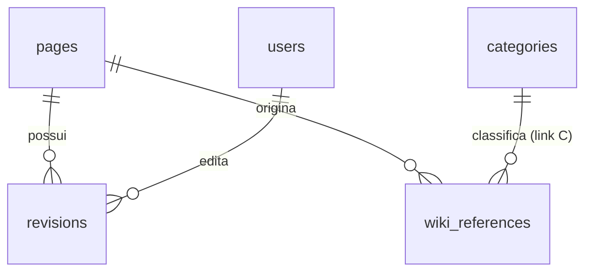
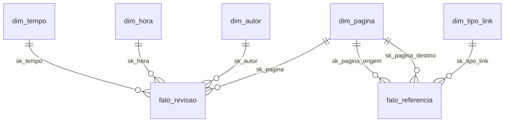

# nLab Data Warehouse (OLAP): Modelagem Dimensional, ETL e Consultas Analíticas

> **Projeto acadêmico (Tópicos em Banco de Dados):** constelação de fatos (Kimball) sobre o dataset do nLab: **1.000.000 de páginas, 1.359.557 revisões e 5.229.489 referências**.

## Sumário
1. [Contexto e origem dos dados](#1-contexto-e-origem-dos-dados)
2. [Banco operacional (OLTP)](#2-banco-operacional-oltp)
3. [Modelagem dimensional](#3-modelagem-dimensional)
4. [ETL](#4-etl)
5. [Consultas analíticas](#5-consultas-analíticas)
6. [Benchmark OLTP x OLAP](#6-benchmark-oltp-x-olap)
7. [Reprodução](#7-reprodução)
8. [Decisões, limitações e qualidade dos dados](#8-decisões-limitações-e-qualidade-dos-dados)

---

## 1. Contexto e origem dos dados

O **nLab** é uma wiki colaborativa de Matemática, Física Teórica e Teoria das Categorias. O banco operacional (`nlab_db`) suporta edição, versionamento e links entre verbetes. O DW responde perguntas de negócio como ritmo de crescimento, concentração de autoria, sazonalidade e rede de links.

> [!IMPORTANT]
> **Origem dos dados.** O `nlab_db` completo é um conjunto **gerado/sintético** de grande volume, e não uma extração do nLab real. Isso aparece nos dados: a distribuição por dia da semana e por faixa do dia é praticamente uniforme, só há 3 autores e 3 categorias, e todas as revisões de uma mesma página têm a mesma data. Os números abaixo são reais para esse dataset, mas os "insights" não descrevem a comunidade verdadeira do nLab.
>
> O repositório inclui apenas um **seed de amostra** (`seeds/sample_oltp.sql`, 500 páginas e 500 revisões, sem `wiki_references`). Ele serve para provar que o fluxo roda do zero com Docker. Os números completos exigem o dump completo do `nlab_db`, que não é versionado por causa do tamanho. Para usá-lo, restaure-o em um MariaDB e aponte `NLAB_DB_HOST/PORT` para ele.

## 2. Banco operacional (OLTP)

| Tabela | Linhas | Descrição |
| :--- | ---: | :--- |
| `pages` | 1.000.000 | Verbetes |
| `revisions` | 1.359.557 | Histórico de edições (com `content`) |
| `wiki_references` | 5.229.489 | Links `L` (4 M), categorias `C` (1 M), redirects `R` (150 mil), imagens `I` (80 mil) |
| `categories` | 6 | 3 nomes distintos, cada um duplicado |
| `users` | 3 | Autores |



## 3. Modelagem dimensional

**Constelação de fatos** (duas tabelas fato compartilhando a dimensão `dim_pagina`).



| Fato | Grão | Medidas |
| :--- | :--- | :--- |
| `fato_revisao` | 1 revisão de uma página por um autor | `qtd_revisoes` (aditiva, contador unitário), `eh_primeira_revisao` (aditiva), `delta_tamanho` (aditiva), `tamanho_conteudo` (**semi-aditiva**, usar AVG/MAX), `dias_desde_rev_anterior` e `numero_revisao` (**não aditivas**). Dimensão degenerada: `id_revisao_oltp` |
| `fato_referencia` | 1 linha de `wiki_references` | `qtd_links` (aditiva), `eh_destino_resolvido` (aditiva). Degenerada: `id_referencia_oltp` |

| Dimensão | Linhas | Observação |
| :--- | ---: | :--- |
| `dim_tempo` | 4.646 | Calendário **contínuo** de 2014-01-01 a 2026-09-20, gerado pelo ETL |
| `dim_hora` | 24 | Hora do dia e faixa (Madrugada/Manhã/Tarde/Noite) |
| `dim_autor` | 4 | 3 usuários + autor anônimo. **SCD tipo 1** (a faixa de contribuição é derivada da fato e recalculada em cada carga) |
| `dim_pagina` | 1.000.000 | Categoria desnormalizada e deduplicada por nome |
| `dim_tipo_link` | 4 | L, C, I, R |

**Star schema em vez de snowflake.** As categorias são 3 valores de baixa cardinalidade, e uma `dim_categoria` normalizada só adicionaria um JOIN sem ganho de armazenamento relevante. Por isso foram desnormalizadas em `dim_pagina`. Os atributos de tempo ficam em uma única `dim_tempo` pelo mesmo motivo.

## 4. ETL

Script: [`src/etl.py`](src/etl.py) (Python + SQL no próprio MariaDB). DDL em [`sql/01_schema_dw.sql`](sql/01_schema_dw.sql) e [`sql/01b_post_load.sql`](sql/01b_post_load.sql).

1. **DDL** recria o schema (idempotente).
2. **Staging** (`stg_revisao`, `stg_categoria_pagina`): extrai as revisões sem o texto (só o tamanho em caracteres) e a categoria real de cada página.
3. **Dimensões:** `dim_tempo` e `dim_hora` são geradas pelo Python, enquanto `dim_autor`, `dim_pagina` e `dim_tipo_link` vêm de `INSERT…SELECT`.
4. **Fatos:** `fato_revisao` usa window functions (`ROW_NUMBER`, `LAG`) para `numero_revisao`, `delta_tamanho` e `dias_desde_rev_anterior`. `fato_referencia` é carregada em lotes de 500 mil ids e resolve o destino do link por nome.
5. **Pós-carga:** os índices secundários e as FKs são criados **depois** da carga em massa, e a faixa de contribuição dos autores é recalculada.
6. **Validação:** `validate_load()` reconcilia OLTP e DW. Os testes são contagens de revisões, páginas e referências, `SUM(qtd)` contra `COUNT`, órfãos de FK e continuidade do calendário. O ETL sai com código 1 se algum falhar.

Registros que não puderam ser carregados vão para `etl_rejeitados` (hoje 0). `python3 src/etl.py --only-validate` roda só a reconciliação.

Resultado da última carga completa (~150 s), com todas as validações **OK**:

| Tabela | Linhas |
| :--- | ---: |
| `dim_tempo` | 4.646 |
| `dim_hora` | 24 |
| `dim_autor` | 4 |
| `dim_pagina` | 1.000.000 |
| `dim_tipo_link` | 4 |
| `fato_revisao` | 1.359.557 |
| `fato_referencia` | 5.229.489 |

## 5. Consultas analíticas

As 10 consultas estão em [`sql/02_queries_olap.sql`](sql/02_queries_olap.sql), separadas por `-- @@QUERY`.

| # | Tema | Recursos |
| :-: | :--- | :--- |
| 1 | Evolução por ano e trimestre | `GROUP BY … WITH ROLLUP` (subtotal por ano e total geral) |
| 2 | Ranking e concentração de autores | `DENSE_RANK`, `SUM() OVER ()`, **soma acumulada** com frame `ROWS UNBOUNDED PRECEDING` |
| 3 | Engajamento por categoria | Agregações, `SUM(SUM()) OVER ()`, medidas semi-aditivas com `AVG` |
| 4 | Sazonalidade semanal | `SUM(SUM()) OVER ()` |
| 5 | Média móvel de 3 meses | `AVG() OVER (ROWS BETWEEN 2 PRECEDING AND CURRENT ROW)` sobre calendário contínuo |
| 6 | Crescimento MoM e YoY | `LAG`, `LEAD` |
| 7 | Ranking de categorias por ano | `RANK() OVER (PARTITION BY ano …)` |
| 8 | Quartis de intensidade mensal | `NTILE(4)`, `PERCENT_RANK` |
| 9 | Páginas mais referenciadas | 2ª fato, `DENSE_RANK`, `ROW_NUMBER() OVER (PARTITION BY categoria)` |
| 10 | Atividade por faixa do dia | `dim_hora` |

Resultados que merecem leitura crítica:
- A Consulta 2 mostra Urs Schreiber com 41,60%, Mike Shulman com 33,31% e Todd Trimble com 25,10% das revisões (acumulado 100%).
- A Consulta 6 mostra −36% de variação mensal em 2026-09, porque esse mês só tem 20 dias de dados (efeito do corte, e não uma queda real).
- Na Consulta 9, 8 verbetes concentram cerca de 40 mil links cada, e o restante tem poucas dezenas. É uma distribuição bem concentrada, típica do gerador.

## 6. Benchmark OLTP x OLAP

Script [`src/benchmark.py`](src/benchmark.py), que grava o resultado em [`docs/benchmark.md`](docs/benchmark.md) (mesmo servidor MariaDB; mediana de 3 execuções no DW e 1 no OLTP).

| Consulta | OLTP (s) | DW (s) | Speedup |
|---|---:|---:|---:|
| B1 - Revisões por ano/mês | 1,24 | 1,07 | 1,2x |
| B2 - Revisões por categoria | > 300 (timeout) | 1,82 | > 165x |
| B3 - Revisões por autor | 2,05 | 1,03 | 2,0x |

Leitura honesta dos números:
- Nas consultas que usam só `revisions` (B1 e B3), o ganho do DW é **pequeno** (1,2x a 2x). Com 1,36 M de linhas, o OLTP já agrega rápido.
- O ganho grande aparece quando a pergunta exige juntar tabelas. Em B2, a categoria só existe via `wiki_references` (5,2 M de linhas, sem índice em `page_id`), e a consulta no OLTP não terminou em 300 s. No DW a categoria já está desnormalizada em `dim_pagina`, e a consulta leva menos de 2 s.
- Os tempos de B2 no OLTP dependem da falta de índice. Com um índice em `wiki_references(page_id, link_type)` o OLTP ficaria bem mais rápido, então o speedup deve ser lido como "sem tuning do OLTP".
- Os planos de execução (`EXPLAIN`) estão em `docs/benchmark.md`.


## 7. Reprodução

```bash
cp .env.example .env        # ajuste NLAB_DB_PASSWORD (e a porta, se precisar)
./run.sh                    # sobe o Docker (se a porta estiver livre), roda ETL + validação + consultas
```

O `run.sh` só sobe o Docker se não houver um MariaDB respondendo em `NLAB_DB_HOST:NLAB_DB_PORT`. Com o Docker, o banco usa o seed de amostra (500 páginas), e as consultas que dependem de `fato_referencia` voltam vazias.

Passo a passo manual:
```bash
docker compose up -d --wait
python3 -m venv .venv && .venv/bin/pip install -r requirements.txt
.venv/bin/python3 src/etl.py
.venv/bin/python3 src/run_queries.py
.venv/bin/python3 src/benchmark.py
```

Notas:
- O `docker-compose.yml` usa `mariadb:11.8`, porque o dump traz a collation `utf8mb4_uca1400_ai_ci` (MariaDB ≥ 11.3).
- O volume `:ro,z` do seed é necessário em hosts com SELinux (Fedora/RHEL).
- As credenciais ficam no `.env` (fora do git). Variáveis: `NLAB_DB_HOST`, `NLAB_DB_PORT`, `NLAB_DB_USER`, `NLAB_DB_PASSWORD`.

## 8. Decisões, limitações e qualidade dos dados

Problemas encontrados no OLTP e como o ETL os trata:

| Problema no OLTP | Tratamento |
| :--- | :--- |
| `revisions.number` vale **1 em todas as linhas** | `numero_revisao` e `eh_primeira_revisao` são recalculados com `ROW_NUMBER() OVER (PARTITION BY page_id ORDER BY created_at, id)` |
| `pages.category_id` é **NULL em 100% das páginas** | A categoria vem dos links tipo `C` de `wiki_references` (1 por página) |
| `categories` tem 6 linhas para 3 nomes | `dim_pagina` guarda o **nome**, o que deduplica |
| `wiki_references.target_page_id` é sempre NULL | O destino dos links `L` e `R` é resolvido pelo nome (`referenced_name = pages.name`, único). 2.330.494 dos 4.000.000 links `L` têm destino existente |
| `revisions.author` é NULL, mas `author_id` é preenchido | A dimensão usa `author_id`, com fallback por nome e depois autor anônimo |

Limitações conhecidas:
- **Dados sintéticos** (ver seção 1): todas as revisões de uma página têm a mesma data, então `dias_desde_rev_anterior` é sempre 0 e, por consequência, a Consulta 3 mostra 0,0.
- A carga é **completa** (full reload), sem incremental. Para 6,6 M de linhas ela leva cerca de 2,5 minutos.
- **SCD tipo 1** em `dim_autor`: com 3 autores e uma faixa derivada, o histórico não agrega valor.
- O `dim_autor` tem 4 linhas (3 usuários e o anônimo, que não tem revisões neste dataset).
- O mês parcial (2026-09, até o dia 20) distorce as consultas de variação mensal.

## Estrutura

```
nlab_dw/
├── docker-compose.yml     # MariaDB 11.8 + seed
├── .env.example           # modelo de credenciais (.env não é versionado)
├── run.sh                 # ETL + validação + consultas
├── requirements.txt
├── seeds/sample_oltp.sql  # amostra do OLTP (500 páginas)
├── sql/
│   ├── 01_schema_dw.sql   # DDL: dimensões, fatos, staging
│   ├── 01b_post_load.sql  # índices e FKs pós-carga
│   └── 02_queries_olap.sql
├── src/
│   ├── etl.py             # ETL + validação
│   ├── run_queries.py
│   └── benchmark.py
└── docs/benchmark.md      # gerado pelo benchmark
```
